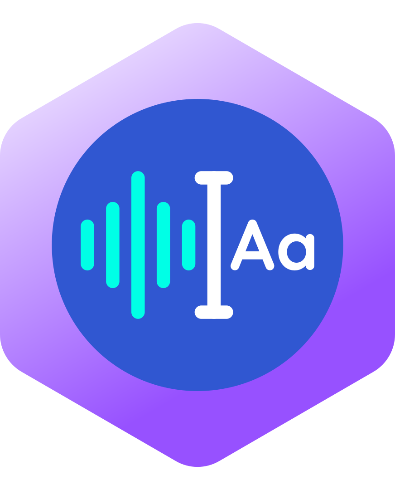
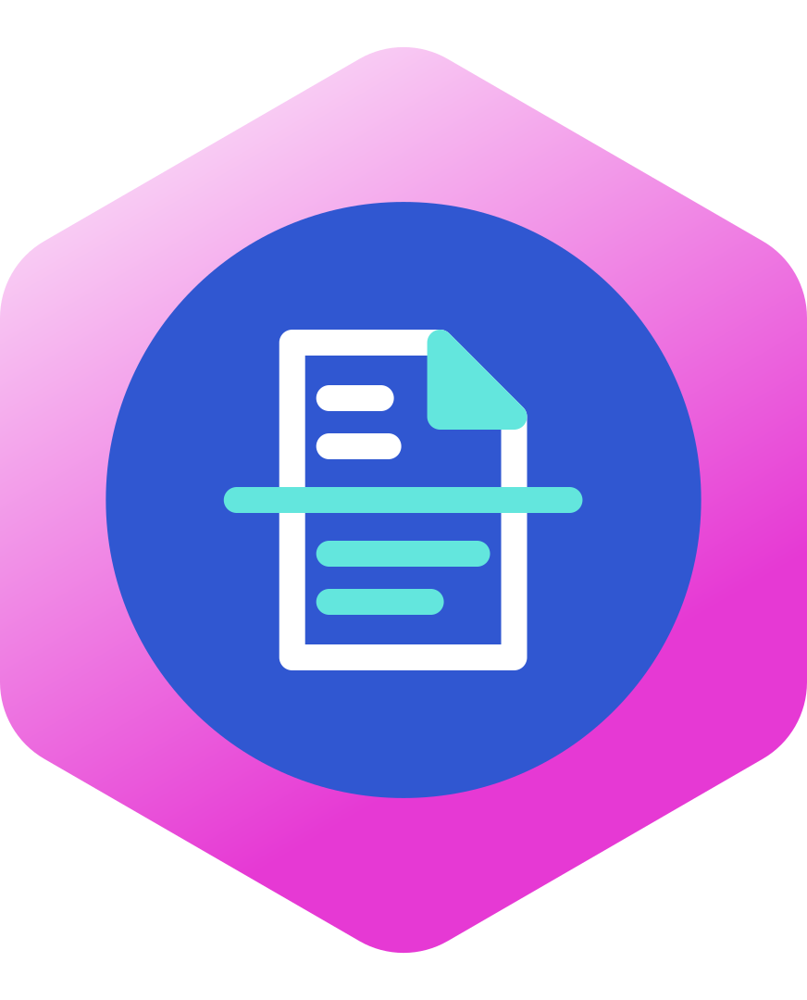

# Skills de Clovy: iconos y descripción

Iconos oficiales en SVG (fuente: Drive › Clovai - Recursos WEB). Formato hexágono, 872.78 × 1080, círculo central en azul eléctrico `#3057D1`.

| Icono | Skill | Archivo |
|---|---|---|
|  | **Clovy QWERTY** | `clovy-qwerty.svg` |
|  | **Clovy Origami** | `clovy-origami.svg` |

---

## Clovy QWERTY: historia clínica por voz

**Qué hace:** escucha la consulta entre el médico y el paciente y la deja escrita en la historia clínica de Clovai. Convierte la conversación en la nota clínica, sin digitar.

**Propósito:** quitarle el teclado al médico. La consulta vuelve a ser con el paciente, no con la pantalla. Menos tiempo documentando, notas completas y consistentes, y más consultas atendidas sin alargar la jornada.

**Lectura del icono:** onda de voz (turquesa) → cursor de texto → "Aa". La voz entra y sale texto.

**Mensaje clave:** *Deja el teclado. Mira a tu paciente.*

---

## Clovy Origami: de documento a información estructurada

**Qué hace:** lee documentos clínicos y administrativos (órdenes, resultados de laboratorio externos, remisiones, epicrisis y autorizaciones en papel o PDF), extrae la información y la organiza en los campos correctos de Clovai.

**Propósito:** acabar con la transcripción manual y con los documentos sueltos que nadie consulta. Lo que llega en papel queda como dato utilizable, conectado a la historia del paciente y listo para facturar, auditar y tomar decisiones.

**Lectura del icono:** documento que atraviesa una línea de escaneo. Arriba es texto plano (blanco) y abajo sale estructurado (turquesa). Como en el origami, el mismo papel toma una forma con orden.

**Mensaje clave:** *El papel entra. El dato sale.*

> ⚠️ La funcionalidad de Origami se describió a partir del icono aprobado (2026-10-12) porque no hay ficha de producto en Drive. Hay que validarla con Producto (Angie) antes de usarla en piezas públicas.
